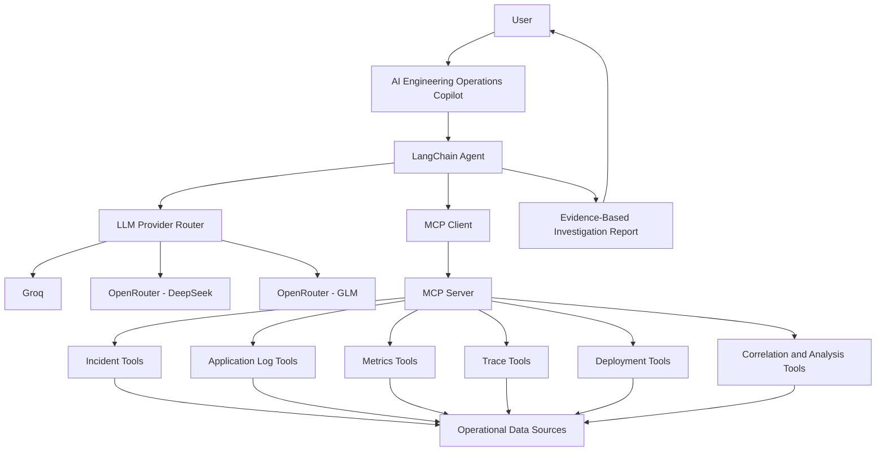
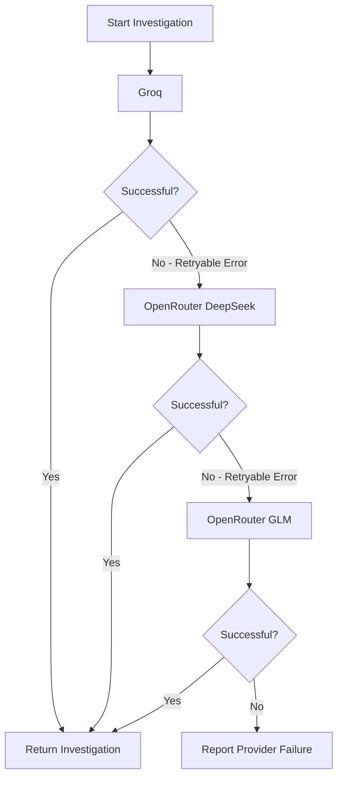

# AI Engineering Operations Copilot

**An MCP-powered AI agent for intelligent incident investigation, observability analysis, and engineering operations.**

[](https://www.python.org/)
[](https://modelcontextprotocol.io/)
[](https://www.langchain.com/)
[](https://pytest.org/)

## Overview

AI Engineering Operations Copilot is an AI-powered incident investigation system built using **Python, Model Context Protocol (MCP), LangChain, and multiple LLM providers**.

It enables an AI agent to investigate engineering incidents by retrieving and correlating structured information from multiple operational data sources, including:

- Incident records
- Application logs
- Service performance metrics
- Distributed traces
- Deployment history
- Error patterns
- Incident-related changes

Instead of manually investigating multiple sources, engineers can ask questions in natural language and receive structured, evidence-based investigation reports.

The system is designed with reliability, modularity, provider resilience, and production-readiness in mind.

> **Current implementation status:** The project uses simulated incident and observability datasets for development and testing. Real production observability integrations are planned, not yet implemented.

## Key Features

- **Natural-language incident investigation:** Ask questions about incidents and receive structured investigation results.
- **MCP-based architecture:** Exposes operational capabilities through reusable MCP tools.
- **Nine integrated MCP tools:** Retrieve incidents, logs, metrics, traces, deployments, and related evidence.
- **Multi-provider LLM architecture:** Supports Groq and OpenRouter models.
- **Automatic provider fallback:** Switches between configured providers when retryable API failures occur.
- **Evidence-based reasoning:** Separates confirmed observations, hypotheses, and unknowns.
- **Context-aware investigation policy:** Restricts unsupported causal claims and fabricated evidence.
- **Configurable token limits:** Controls model generation limits through environment variables.
- **Error handling and logging:** Handles provider failures and records investigation activity.
- **MCP session cleanup:** Closes client sessions after the interactive agent exits.
- **Automated testing:** Uses pytest to validate tool behaviour, provider configuration, and fallback logic.

## Architecture



### Technology Stack

| Component | Technology |
|---|---|
| Programming language | Python 3.12 |
| Package management | uv |
| AI agent framework | LangChain |
| Agent-to-tool communication | Model Context Protocol |
| MCP implementation | FastMCP |
| MCP client integration | mcp-use |
| Primary LLM provider | Groq |
| Additional LLM providers | OpenRouter |
| Testing | pytest |
| Configuration | python-dotenv |
| Version control | Git and GitHub |

## MCP Tools

The project currently implements nine MCP tools.

| Tool | Description |
|---|---|
| `list_incidents` | Retrieves incidents with severity, status, and result-limit filters. |
| `get_incident_details` | Retrieves detailed information about a specific incident. |
| `search_application_logs` | Searches application logs using query, service, and severity filters. |
| `analyze_incident_tool` | Performs structured analysis of an incident and its available evidence. |
| `analyze_error_patterns` | Identifies recurring application error patterns. |
| `get_service_metrics` | Retrieves service performance metrics. |
| `get_trace_details` | Retrieves distributed trace information and span details. |
| `get_deployment_history` | Retrieves deployment records by service and environment. |
| `correlate_incident_changes` | Examines available deployment changes associated with an incident. |

These tools allow the agent to gather evidence from different operational dimensions before generating an investigation report.

## Multi-Provider LLM Architecture

A key reliability feature is the sequential LLM provider fallback mechanism.

The application supports three configurable provider entries:

| Priority | Provider | Model |
|---|---|---|
| 1 | Groq | `openai/gpt-oss-120b` |
| 2 | OpenRouter | `deepseek/deepseek-v4.1-flash` |
| 3 | OpenRouter | `z-ai/glm-5.3-flash` |

### Fallback workflow



The router handles retryable failures such as:

- HTTP 429 rate limits
- HTTP 500, 502, 503, and 504 server errors
- Connection errors and timeouts
- HTTP 402 payment or insufficient-credit errors

Non-retryable failures, including malformed tool calls and invalid requests, are not automatically retried against other providers.

Each provider has configurable generation limits to help control token consumption.

**Important:** Multiple API keys do not necessarily provide independent quotas or credits. Provider fallback improves resilience but does not guarantee uninterrupted availability.

## Investigation and Reasoning Strategy

The agent follows a structured investigation policy designed to improve reliability and reduce unsupported conclusions.

It distinguishes between:

1. **Confirmed observations:** Information directly retrieved from available MCP tools.
2. **Hypotheses:** Possible explanations supported by evidence but not established as fact.
3. **Unknowns:** Information that cannot be verified using the available data.

The investigation policy also ensures that:

- Tools are treated as the source of operational evidence.
- Missing information is explicitly identified.
- Temporal correlation is not automatically treated as causation.
- Trace spans are interpreted as observations, not proof of root cause.
- Simulated data is never presented as production telemetry.
- Recommendations are based on available evidence.

## Example Investigation

**Example prompt:**

```text
Investigate INC-002.

Retrieve its incident details, related application logs,
service metrics, trace information, and deployment history.

Clearly distinguish confirmed observations from hypotheses
and explain what remains unconfirmed.

Identify whether the available evidence is synthetic
or production data.
```

**Example investigation findings based on the current simulated dataset:**

| Evidence source | Observation |
|---|---|
| Incident | INC-002 is a critical database connection timeout incident. |
| Application logs | Connection pool exhaustion and connection timeout errors are recorded. |
| Service metrics | Recorded error rate is 8%, with response latency of 850 ms. |
| Distributed trace | Trace `trace-002` records an error lasting 1,850 ms. |
| Deployment history | Two database deployment records are available, including one failed deployment. |
| Data classification | All current observations come from simulated development data. |

**Investigation conclusion:** Database connection pool exhaustion and connection timeouts are confirmed observations in the available dataset. The precise underlying cause and whether a deployment caused the incident remain unconfirmed.

*The values above illustrate the current simulated dataset, not live production measurements.*

## Project Structure

```text
ai-engineering-ops-copilot/
│
├── src/
│   └── ops_copilot/
│       ├── __init__.py
│       ├── agent.py
│       └── server.py
│
├── tests/
│   ├── test_server.py
│   └── test_provider_router.py
│
├── .env.example
├── .gitignore
├── pyproject.toml
├── uv.lock
└── README.md
```

Additional modules and data files may be present depending on the current development version.

## Getting Started

### Prerequisites

Install the following:

- Python 3.12
- uv package manager
- Git
- API key for at least one supported LLM provider

### 1. Clone the repository

```bash
git clone https://github.com/Ajzel/ai-engineering-ops-copilot.git

cd ai-engineering-ops-copilot
```

### 2. Create a virtual environment

```bash
uv venv --python 3.12
```

Activate it on Windows PowerShell:

```powershell
.venv\Scripts\Activate.ps1
```

### 3. Install dependencies

```bash
uv sync
```

### 4. Configure environment variables

Create a `.env` file in the project root.

```env
# Groq
GROQ_API_KEY=your_groq_api_key
GROQ_MODEL=openai/gpt-oss-120b
GROQ_MAX_TOKENS=1024

# OpenRouter - DeepSeek
OPENROUTER_API_KEY_1=your_openrouter_api_key
OPENROUTER_MODEL_1=deepseek/deepseek-v4.1-flash

# OpenRouter - GLM
OPENROUTER_API_KEY_2=your_second_openrouter_api_key
OPENROUTER_MODEL_2=z-ai/glm-5.3-flash

# OpenRouter generation limit
OPENROUTER_MAX_TOKENS=4096
```

You only need to configure the providers you intend to use. The application should skip providers without configured API keys.

**Security:** Never commit `.env` or expose API keys in source code, logs, screenshots, or GitHub.

### 5. Run the MCP agent

From the project root:

```bash
uv run python src/ops_copilot/agent.py
```

The application initializes the MCP client, connects to the server, discovers available tools, and displays the configured LLM providers.

You can then enter natural-language incident investigation requests.

To exit:

```text
exit
```

## Testing

The project uses pytest for automated testing.

Run the provider router tests:

```bash
uv run python -m pytest tests/test_provider_router.py -v
```

Run the complete test suite:

```bash
uv run python -m pytest -v
```

The test suite covers:

- Provider configuration and priority.
- Behaviour when no providers are configured.
- Retryable and non-retryable provider errors.
- Sequential provider fallback.
- Fallback across all configured providers.
- Behaviour when every provider fails.
- Agent memory configuration.
- MCP tool functionality and error handling.

## Production-Readiness Improvements

The project incorporates several engineering practices intended to support future production deployment.

| Area | Implementation |
|---|---|
| Provider resilience | Sequential multi-provider fallback |
| Token management | Configurable model generation limits |
| Error handling | Retry classification and controlled failure handling |
| Observability | Application logging |
| Resource management | MCP session cleanup |
| Maintainability | Modular MCP server and agent architecture |
| Reliability testing | Automated pytest coverage |
| Investigation safety | Evidence-based reasoning policy |
| Configuration | Environment-based secrets and model settings |

## Current Limitations

This is an actively developed project. The following limitations are important:

- Incident, log, metric, trace, and deployment datasets are currently simulated.
- Live Prometheus metrics are not yet integrated.
- OpenTelemetry instrumentation and real distributed trace collection are planned.
- Grafana, Loki, and Tempo integrations are not yet implemented.
- The system does not currently execute production remediation actions.
- Provider fallback cannot guarantee availability when all providers are unavailable or out of credits.
- Investigation memory is enabled for agent instances, but separate provider attempts do not automatically share persistent conversation memory.

## Roadmap

- [ ] Integrate Prometheus for real-time service metrics.
- [ ] Integrate OpenTelemetry for distributed tracing.
- [ ] Add Grafana, Loki, and Tempo integrations.
- [ ] Implement real-time application log ingestion.
- [ ] Add persistent investigation memory.
- [ ] Introduce historical incident analysis.
- [ ] Add diagnostic health-check capabilities.
- [ ] Build a web-based investigation dashboard.
- [ ] Add authentication and role-based access control.
- [ ] Add deployment and containerisation support.
- [ ] Introduce safe, approval-based remediation workflows.

## Design Philosophy

The goal is not simply to connect an LLM to operational tools. It is to build an engineering assistant that can:

- Retrieve evidence before reasoning.
- Correlate information across multiple systems.
- Communicate uncertainty clearly.
- Handle model-provider failures gracefully.
- Avoid inventing operational facts.
- Evolve from simulated datasets to real observability infrastructure.

## Author

**Mohammed Ajzel**

MSc Artificial Intelligence, Machine Learning and Data Science Graduate

- GitHub: [@Ajzel](https://github.com/Ajzel)
- LinkedIn: [Muhammed Ajzel](https://linkedin.com/in/muhammed-ajzel)
- Portfolio: [vitaely.me/ajzel](https://vitaely.me/ajzel)

## License

This project is currently a personal engineering project. Add a `LICENSE` file before distributing it under an open-source licence.
